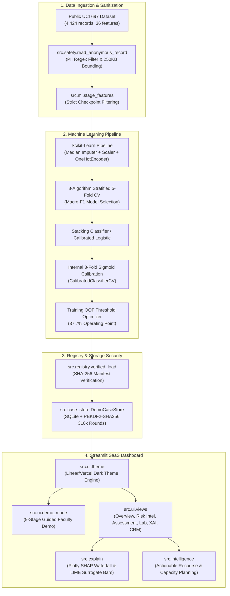

# System Architecture & Technical Specifications

**Student Retention Intelligence (EduPulse SaaS Architecture)**  
*INT395 Capstone Project — Group 12*

---

## 1. High-Level System Architecture



---

## 2. Component Directory Structure

```text
Student_Retention_Intelligence_Final_Release/
├── app.py                      # Master Streamlit application shell & view router
├── Dockerfile                  # Container definition with health checks
├── requirements.txt            # Production dependencies
├── requirements-lock.txt       # Tested frozen versions
├── RELEASE_MANIFEST.json       # SHA-256 hashes of all project files
│
├── data/
│   ├── students.csv            # Public UCI 697 dataset (4,424 rows)
│   └── independent_cohort.csv  # Shifted external evaluation cohort (55 rows)
│
├── artifacts/                  # Verified model binaries & metrics
│   ├── model.joblib            # Calibrated scikit-learn model bundle
│   ├── metrics.json            # Model evaluation metrics & ROC/PR curves
│   └── manifest.json           # SHA-256 artifact integrity manifest
│
├── local_demo/
│   └── cases.sqlite3           # Local SQLite demo CRM store (fictional cases)
│
├── src/
│   ├── ml.py                   # Machine learning pipelines, CV, curves & calibration
│   ├── train.py                # Command-line training & artifact generation
│   ├── intelligence.py         # Support recommendations, recourse & capacity planner
│   ├── explain.py              # SHAP & LIME local and global visual explanations
│   ├── case_store.py           # Role-based SQLite CRM with PBKDF2-SHA256 hashing
│   ├── registry.py             # Model artifact integrity verification
│   ├── safety.py               # Input validation, PII detection & size bounding
│   ├── monitor.py              # Covariate shift & drift detection CLI
│   ├── external_eval.py        # Independent cohort evaluation CLI
│   └── ui/                     # Modular presentation & styling layer
│       ├── theme.py            # Dark SaaS CSS injection & Plotly dark templates
│       ├── components.py       # Reusable cards, headers, badges & before/after widgets
│       ├── demo_mode.py        # 9-Stage guided Faculty Demo Mode
│       └── views.py            # Complete view renderers for all dashboard tabs
│
├── tests/                      # Automated unit test suite (42 tests, 100% pass)
│   ├── test_case_store.py      # Authorization, password hashing & audit tests
│   ├── test_dataset.py         # UCI dataset schema & stage filtering tests
│   ├── test_external_eval.py   # Bootstrap CI & external cohort evaluation tests
│   ├── test_final.py           # Integration & regression tests
│   ├── test_intelligence_advanced.py # Recourse, capacity & persona tests
│   ├── test_ml.py              # Preprocessing pipelines & model training tests
│   ├── test_monitor.py         # KS-statistic & covariate shift tests
│   ├── test_registry.py        # SHA-256 manifest verification tests
│   └── test_safety.py          # PII detection & malicious input rejection tests
│
└── scripts/
    ├── smoke_app.py            # Headless Streamlit AppTest integration runner
    ├── audit_explanations.py   # SHAP & LIME mathematical consistency check
    └── create_demo_user.py     # CLI to bootstrap local CRM administrators
```

---

## 3. Trust Boundaries & Security Architecture

1. **Input Perimeter:**
   - Any CSV upload is inspected by `src/safety.py`. Inputs exceeding 250 KB or containing strings matching PII patterns (`name`, `email`, `phone`, `student_id`, `aadhaar`) are rejected before parsing.
   - Values are strictly cast to numeric UCI codes; non-numeric strings, infinite floats, or NaN-dominated rows trigger a schema validation error.

2. **Deserialization Boundary:**
   - Python `joblib` / `pickle` deserialization is hazardous if files are tampered with.
   - `src/registry.py` enforces a cryptographic SHA-256 check against `manifest.json` before any `joblib.load()` occurs.

3. **Access Control & Identity Boundary:**
   - Passwords are salted with 16 random cryptographic bytes (`secrets.token_bytes(16)`) and hashed using PBKDF2-SHA256 with **310,000 rounds**.
   - Verification uses constant-time comparison (`hmac.compare_digest`) to prevent timing side-channel attacks.
   - Row-level access control in SQLite ensures Advisors can only query or update cases they own. Administrators retain oversight via an append-only audit log.
