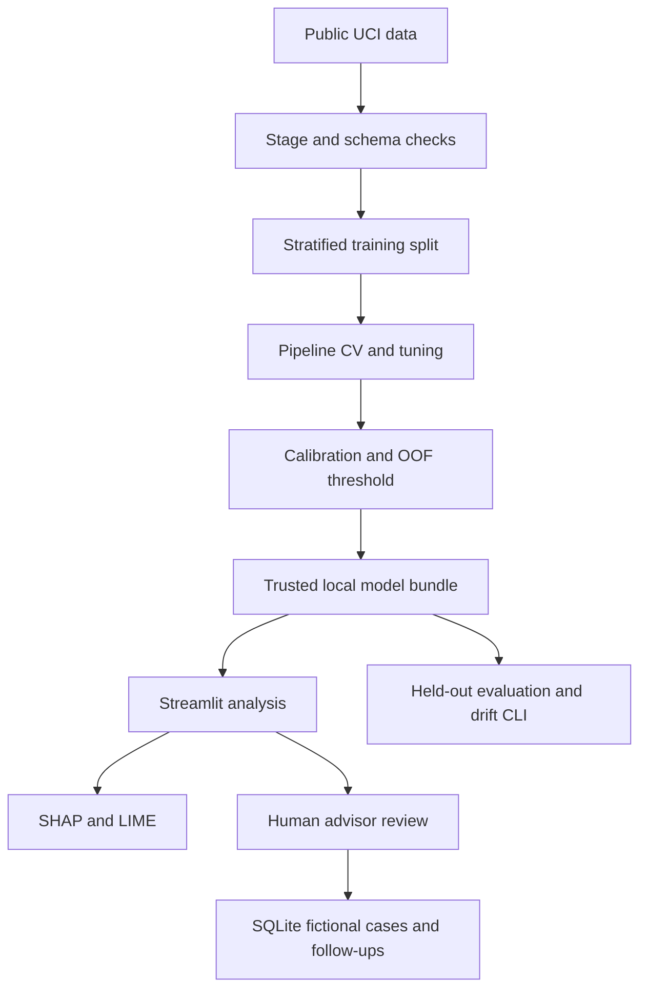

# Architecture

src/ml.py owns model experiments. src/intelligence.py owns support rules and cohort inference. src/safety.py bounds uploads. src/explain.py owns explanations. src/case_store.py enforces local advisor ownership using the authenticated Streamlit actor. Its Python methods assume a trusted caller; they are not remotely exposed APIs. src/registry.py verifies local model hashes before loading trusted joblib files. A malicious model publisher can replace both hashes and executable pickle content.

Uploads remain in session memory. SQLite contains fictional case references, structured support/contact outcomes and user password hashes. Audit is local and mutable by the OS/database administrator, not tamper-proof. Case identity is intentionally not automatically linked to historical UCI rows.
